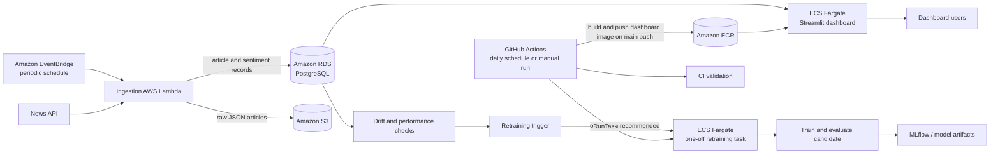

# Emotion Intelligence Platform

An AWS-hosted platform for collecting news articles, analyzing emotion, viewing results in a Streamlit dashboard, and monitoring model/data quality. The project also has a conditional retraining workflow: it checks existing monitoring data and runs training and evaluation only when its trigger recommends retraining.

> **Architecture note:** The diagrams supplied with the project show a broad, production-grade MLOps reference design. This README separates the components described in the current project from optional/reference components such as Feast, a general-purpose feature store, and automatic production model promotion. Verify those components in the AWS account and repository before describing them as deployed.

## Contents

- [Architecture](#architecture)
- [Main workflows](#main-workflows)
- [AWS components](#aws-components)
- [Repository layout](#repository-layout)
- [Local setup](#local-setup)
- [Configuration](#configuration)
- [Run the data pipeline](#run-the-data-pipeline)
- [Run monitoring and conditional retraining](#run-monitoring-and-conditional-retraining)
- [GitHub Actions](#github-actions)
- [Build and run containers](#build-and-run-containers)
- [Security and operations](#security-and-operations)
- [Known boundaries](#known-boundaries)

## Architecture

The supplied diagrams describe two connected but distinct flows: scheduled ingestion/dashboard operation, and model/data workflows. The daily retraining task is separate from ingestion.



The EventBridge schedule shown in the ingestion architecture controls ingestion. The GitHub Actions daily schedule controls the separate monitoring/retraining task. They have different purposes and should not be confused.

## Main workflows

### 1. Scheduled ingestion

1. EventBridge invokes the ingestion Lambda on its configured schedule (the supplied diagram shows every five minutes).
2. The Lambda requests articles from the configured news API and performs the ingestion-side processing described by the project.
3. Raw article JSON is stored in S3; article records and related values are stored in PostgreSQL on Amazon RDS.

The ingestion Lambda is for ingestion automation. It is not the ECS retraining task.

### 2. Data preparation and normal model pipeline

The project’s DVC pipeline describes the stages for preparing data and running model work, including preprocessing, feature engineering, emotion inference, training, and evaluation. Run stages in the order defined by `dvc.yaml`; DVC tracks dependencies and skips stages when its dependency/output checks determine they do not need to rerun.

The exact data-change trigger depends on the configured DVC dependencies and data sources. DVC does not automatically get invoked merely because a database row changes unless an external scheduler/event invokes it.

### 3. Daily monitoring and conditional retraining

The GitHub Actions workflow starts a one-off ECS Fargate task once per day (or on manual dispatch). The task runs the retraining container, which follows this decision flow:

```text
drift check -> performance check -> retraining trigger
                                      |
                         recommendation required
                                      v
                         retrain.py -> train.py -> evaluate.py
```

If the trigger blocks or does not recommend retraining, training is skipped. This daily flow uses existing monitoring data; it does not run ingestion, preprocessing, or feature engineering. A retraining recommendation is not itself approval to deploy a model.

### 4. Prediction and serving

The dashboard image runs Streamlit on port `8051` in ECS Fargate and reads application data from PostgreSQL. Prediction code uses the model configured by the project. Training a new candidate does not automatically replace the model already used by the running dashboard. Any model promotion or serving-image/service update must be an explicitly configured and separately verified step.

## AWS components

| Component | Purpose |
|---|---|
| Amazon EventBridge | Schedules ingestion Lambda invocations. |
| AWS Lambda | Fetches and processes incoming news data. |
| Amazon RDS for PostgreSQL | Stores application/article data used by the dashboard and project scripts. |
| Amazon S3 | Stores raw JSON and model/data artifacts as configured. |
| Amazon ECR | Stores separate dashboard and retraining container images. |
| Amazon ECS with Fargate | Runs the Streamlit dashboard service and the separate one-off retraining task. |
| AWS Secrets Manager | Holds database/API credentials referenced by workloads. |
| Amazon CloudWatch Logs | Receives Lambda, ECS, and CodeBuild logs when configured. |
| AWS CodeBuild | Builds the retraining image from the GitHub source and pushes it to ECR. |
| MLflow | Tracks model runs/artifacts where configured by the project. |

The reference diagram also includes Feast as a feature store and a general model registry lifecycle. Treat those as planned/reference components unless the repository and AWS account contain their actual configuration.

## Repository layout

The project has evolved; use the actual repository tree as the source of truth. Files discussed in this project include:

```text
.
├── .github/workflows/pipeline.yml  # CI, image build, scheduled retraining task
├── data/                           # Project data, subject to .gitignore/DVC policy
├── evaluation/                     # Evaluation outputs or utilities
├── models/                         # Model artifacts and label encoder
├── monitoring/                     # Drift, performance, and trigger scripts
├── scripts/                        # Pipeline/helper scripts
├── src/
│   ├── app.py                      # Streamlit dashboard
│   ├── predict.py                  # Prediction/model loading
│   ├── train.py                    # Model training
│   ├── evaluate.py                 # Candidate evaluation
│   ├── retrain.py                  # Conditional retraining orchestration
│   └── db_connection.py            # Database connection helper
├── dvc.yaml                        # DVC stages
├── dvc.lock                        # Locked DVC stage state
├── Dockerfile                      # Dashboard container
└── requirements.txt                # Development/project dependencies
```

Do not commit credentials, `.env` files, virtual environments, generated reports, training checkpoints, or large model artifacts unless the project’s DVC/storage policy explicitly requires them.

## Local setup

Use Python 3.12 for the repository workflow unless a particular container or dependency requires another version.

```bash
python -m venv .venv
```

Activate the environment, then install dependencies and inspect the pipeline:

```bash
python -m pip install --upgrade pip
pip install -r requirements.txt
dvc dag
```

On Windows PowerShell, activate with:

```powershell
.\.venv\Scripts\Activate.ps1
```

Never put real credentials in source control. Configure local credentials using the project’s supported environment or AWS profile mechanism.

## Configuration

Configure the variables required by each script/container. Names below are based on the code and workflow discussed for this project; check the current code for any additional required values.

| Setting | Purpose |
|---|---|
| `AWS_REGION` | AWS region, currently `ap-south-1`. |
| `S3_BUCKET_NAME` | S3 bucket used by monitoring/artifact code, currently `emotion-intelligence-raw-data`. |
| `INGESTION_SECRET_ARN` | Secrets Manager ARN containing PostgreSQL connection credentials. |
| `MLFLOW_TRACKING_URI` | Set if the training/evaluation code uses a remote MLflow tracking server. |

For GitHub Actions, add these **repository variables** under **Settings → Secrets and variables → Actions → Variables**:

| Variable | Purpose |
|---|---|
| `AWS_ROLE_ARN` | IAM role assumed by GitHub Actions through OIDC. |
| `RETRAINING_SUBNET_ID` | VPC subnet used by the one-off ECS task. |
| `RETRAINING_SECURITY_GROUP_ID` | Security group attached to the ECS task ENI. It must allow the required database connectivity. |

The GitHub OIDC role needs the required ECS `RunTask` and `iam:PassRole` permissions. The ECS task role needs permissions for the database secret and any S3/MLflow resources used by the scripts. Keep secrets in Secrets Manager or GitHub Secrets, not plain-text workflow variables.

## Run the data pipeline

Inspect available stages:

```bash
dvc dag
```

Run the configured pipeline:

```bash
dvc repro
```

The DVC pipeline is separate from the daily drift-check/retraining ECS task. Confirm the DVC stage dependencies and outputs in `dvc.yaml` before relying on new database data to trigger a stage; database changes alone are not automatically detected by DVC unless represented as dependencies or connected to an external trigger.

## Run monitoring and conditional retraining

For a local/manual run, activate the project environment and run the orchestrator:

```bash
python src/retrain.py
```

The retraining task image is stored separately from the dashboard image. The CodeBuild project builds and pushes the tag:

```text
901099689002.dkr.ecr.ap-south-1.amazonaws.com/emotion-intelligence:retraining
```

The ECS task definition family `emotion-intelligence-retraining` should point to this image and use the task startup command `python src/retrain.py` (provided by the image’s `CMD`, unless overridden in the task definition). It is a one-off task, not a service, and should not be attached to the dashboard service.

## GitHub Actions

The workflow at `.github/workflows/pipeline.yml` is intended to:

- Run validation on pushes and pull requests to `main` and `develop`.
- Build and push the dashboard image on pushes to `main`. The shown workflow does not update ECS.
- Start the conditional retraining ECS task on a daily schedule and on manual dispatch.
- Wait for the ECS task to stop and report a non-zero exit code as a failed workflow.

The schedule `30 0 * * *` means 00:30 UTC (6:00 AM India Standard Time). GitHub scheduled workflows run from the repository’s default branch. To test manually, commit the workflow to the default branch, then select **Actions → Emotion Intelligence CI-CD → Run workflow**.

The scheduled job does not invoke ingestion or the full DVC pipeline. It checks existing monitoring data and lets `retrain.py` decide whether training/evaluation should run.

## Build and run containers

### Dashboard image

The repository `Dockerfile` is for the Streamlit dashboard. The dashboard container listens on port `8051`. GitHub Actions builds a commit-tagged dashboard image and pushes it to ECR; the workflow shown does not update an ECS service.

### Retraining image

The separate CodeBuild project obtains source from GitHub, creates the retraining Dockerfile during the build (so that Dockerfile does not need to be committed), builds the image with startup command `python src/retrain.py`, and pushes the `:retraining` tag to ECR. CodeBuild must run in privileged mode and its service role must be allowed to authenticate to ECR and push to the target repository.

## Security and operations

- Use IAM roles and GitHub OIDC rather than long-lived AWS access keys in GitHub.
- Restrict IAM permissions to the resources required by each workload.
- Store database/API credentials in Secrets Manager and grant access only to the task/Lambda roles that need them.
- Keep the RDS database private. Configure the ECS task subnet/security group so it can reach RDS on the required database port.
- Send ECS and CodeBuild logs to CloudWatch and inspect task logs when a workflow fails.
- A non-zero ECS container exit code means the task failed; inspect its CloudWatch log stream for the underlying script error.
- Review model evaluation and quality gates before promoting any candidate model to production.

## Known boundaries

- The retraining automation evaluates a recommendation and may train/evaluate a candidate. It does not automatically update the dashboard service or make the dashboard load a new model.
- The dashboard ECS service and the one-off retraining task use separate task definitions and must remain separate.
- The five-minute ingestion frequency shown in the diagram is the intended EventBridge schedule in that architecture; verify the actual AWS rule configuration for the live interval.
- Feature Store/Feast, automatic registry stage promotion, production deployment, and alerts should be described as implemented only if their configuration is present and operational.
- Database changes do not automatically run DVC unless an external event/schedule invokes the pipeline and DVC can detect the data dependency.

## License

Add the project’s chosen license here before publishing or distributing the repository.
